# zipup_helper

디자인 작업에 쓰는 **폴더와 사진을 쉽게 정리해 주는 프로그램**입니다.

이 프로그램으로 할 수 있는 일은 다음과 같습니다.

- 프로젝트 폴더를 버튼 몇 번으로 만들 수 있습니다.
- PPT 파일 안에 들어 있는 사진을 한 번에 꺼낼 수 있습니다.
- 사진을 크게 보고, 포토샵으로 바로 열 수 있습니다.
- 작업한 파일을 정해진 폴더로 쉽게 보낼 수 있습니다.

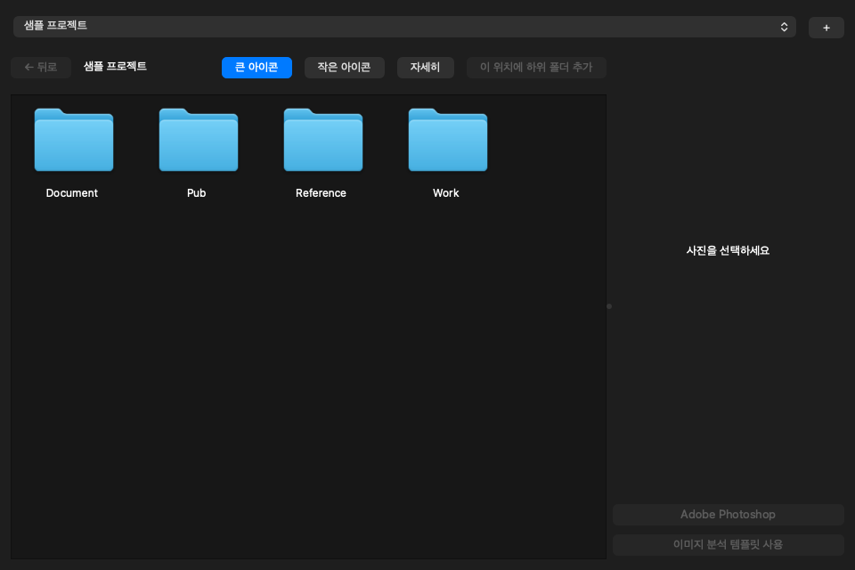

> 이 설명서의 화면은 연습용 샘플 파일로 찍었습니다.

## 목차

1. [설치하기](#설치하기)
2. [프로그램 화면 알아보기](#프로그램-화면-알아보기)
3. [새 프로젝트 만들기](#새-프로젝트-만들기)
4. [PPT에서 사진 꺼내기](#ppt에서-사진-꺼내기)
5. [사진 보기](#사진-보기)
6. [사진 고르기](#사진-고르기)
7. [사진 사용하기](#사진-사용하기)
8. [컴퓨터에 있는 파일 넣기](#컴퓨터에-있는-파일-넣기)
9. [Work, Reference 안에서 정리하기](#work-reference-안에서-정리하기)
10. [Pub 폴더로 보내기](#pub-폴더로-보내기)
11. [문제가 생겼을 때](#문제가-생겼을-때)
12. [아직 안 되는 것](#아직-안-되는-것)

## 설치하기

처음에 **한 번만** 하면 됩니다. 인터넷이 연결되어 있어야 합니다. 순서대로 따라 하면 어렵지 않습니다.

"터미널"과 "PowerShell"은 글자로 컴퓨터에게 명령하는 창입니다. 아래 글자를 **복사해서 붙여넣고 `Enter`** 를 누르면 됩니다. 글자가 많이 지나가도 괜찮습니다.

자기 컴퓨터에 맞는 쪽만 보세요.

- [Mac에서 설치하기](#mac에서-설치하기)
- [Windows에서 설치하기](#windows에서-설치하기)

### Mac에서 설치하기

**1단계. Python 설치하기**

Python은 이 프로그램을 움직이는 데 필요한 도구입니다.

1. [Mac용 Python 설치 파일](https://www.python.org/ftp/python/3.12.10/python-3.12.10-macos11.pkg)을 내려받습니다.
2. 내려받은 파일을 더블클릭합니다.
3. **계속**과 **동의**를 눌러 끝까지 진행합니다. 비밀번호를 물으면 Mac 로그인 비밀번호를 넣습니다.

**2단계. 프로그램 내려받기**

1. [프로그램 페이지](https://github.com/Junsu1115/zipup_helper)를 엽니다.
2. 초록색 **Code** 버튼을 누르고 **Download ZIP**을 누릅니다.
3. 내려받은 파일을 더블클릭해서 압축을 풉니다.
4. `zipup_helper-main` 폴더를 **문서** 폴더로 옮깁니다.

**3단계. 프로그램 설치하기**

1. `⌘ + Space`를 누르고 `터미널`을 입력한 뒤 `Enter`를 누릅니다.
2. 아래 세 줄을 한 줄씩 붙여넣고 `Enter`를 누릅니다. 세 번째 줄은 몇 분 걸릴 수 있습니다.

```bash
cd ~/Documents/zipup_helper-main
python3.12 -m venv .venv
.venv/bin/python -m pip install -r requirements.txt
```

**4단계. Project 폴더 만들기**

프로젝트들이 모일 폴더입니다.

1. Finder를 열고 `⌘ + Shift + H`를 누릅니다.
2. 빈 곳에서 마우스 오른쪽 버튼을 누르고 **새로운 폴더**를 고릅니다.
3. 이름을 `Project`로 짓습니다. 첫 글자만 대문자입니다.

**5단계. 프로그램 켜기**

터미널에 아래 두 줄을 붙여넣으면 프로그램이 켜집니다. **앞으로 쓸 때도 이 두 줄만 하면 됩니다.**

```bash
cd ~/Documents/zipup_helper-main
.venv/bin/python main.py
```

프로그램을 쓰는 동안 터미널 창을 닫으면 프로그램도 꺼지니 그대로 두세요.

### Windows에서 설치하기

> Windows에서는 아직 시험 중이라 안 되는 기능이 있을 수 있습니다. 문제가 생기면 관리자에게 알려 주세요.

**1단계. Python 설치하기**

1. [Windows용 Python 설치 파일](https://www.python.org/ftp/python/3.12.10/python-3.12.10-amd64.exe)을 내려받습니다.
2. 내려받은 파일을 더블클릭합니다.
3. 첫 화면 아래쪽의 **Add python.exe to PATH**를 꼭 체크합니다.
4. **Install Now**를 누르고, 끝나면 **Close**를 누릅니다.

**2단계. 프로그램 내려받기**

1. [프로그램 페이지](https://github.com/Junsu1115/zipup_helper)를 엽니다.
2. 초록색 **Code** 버튼을 누르고 **Download ZIP**을 누릅니다.
3. 내려받은 파일에 마우스 오른쪽 버튼을 누르고 **모두 압축 풀기**를 고릅니다.
4. 그 안의 `zipup_helper-main` 폴더를 **문서** 폴더로 옮깁니다. 폴더를 열었을 때 `main.py`가 바로 보여야 합니다.

**3단계. 프로그램 설치하기**

1. 시작 메뉴에서 `PowerShell`을 찾아 엽니다.
2. 아래 세 줄을 한 줄씩 붙여넣고 `Enter`를 누릅니다. 세 번째 줄은 몇 분 걸릴 수 있습니다.

```powershell
cd "$HOME\Documents\zipup_helper-main"
py -3.12 -m venv .venv
.venv\Scripts\python -m pip install -r requirements.txt
```

**4단계. Project 폴더 만들기**

PowerShell에 아래 줄을 붙여넣습니다.

```powershell
mkdir "$HOME\Project"
```

**5단계. 프로그램 켜기**

PowerShell에 아래 두 줄을 붙여넣으면 프로그램이 켜집니다. **앞으로 쓸 때도 이 두 줄만 하면 됩니다.**

```powershell
cd "$HOME\Documents\zipup_helper-main"
.venv\Scripts\python main.py
```

프로그램을 쓰는 동안 PowerShell 창을 닫으면 프로그램도 꺼지니 그대로 두세요.

### 새 버전으로 바꾸기

1. 프로그램을 끕니다.
2. **문서** 폴더의 `zipup_helper-main` 폴더를 지웁니다. `Project` 폴더는 다른 곳에 있어서 작업 파일은 지워지지 않습니다.
3. **2단계**와 **3단계**를 다시 합니다.

## 프로그램 화면 알아보기

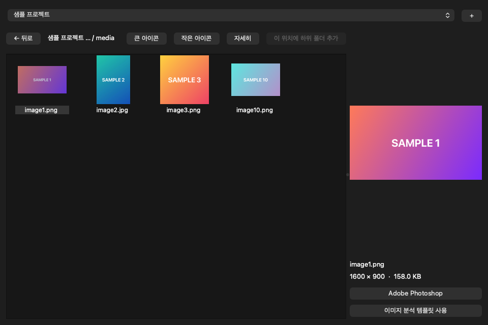

| 위치 | 하는 일 |
|---|---|
| 맨 위 칸 | 프로젝트를 고르는 곳입니다 |
| 맨 위 **+** 버튼 | 새 프로젝트를 만듭니다 |
| **← 뒤로** | 한 칸 위 폴더로 돌아갑니다 |
| **큰 아이콘, 작은 아이콘, 자세히** | 파일이 보이는 모양을 바꿉니다 |
| 가운데 넓은 곳 | 폴더와 사진이 보입니다 |
| 오른쪽 | 고른 사진이 크게 보입니다 |

폴더는 **한 번만 클릭**하면 들어갑니다.

### 폴더가 하는 일

| 폴더 | 무엇을 넣습니까? |
|---|---|
| **Document** | PPT 같은 문서 |
| **Reference** | 참고할 자료 |
| **Work** | 작업 중인 파일 |
| **Pub** | Work에서 골라 보낸 파일 |

## 새 프로젝트 만들기

1. 맨 위의 **+** 버튼을 누르고 **Yes**를 누릅니다.
2. 프로젝트 이름을 적습니다.
3. 폴더를 함께 만들고 싶으면 **하위 폴더들 자동 구성**을 체크합니다. 오른쪽에서 필요한 폴더만 고를 수 있습니다.
4. **OK**를 누릅니다.

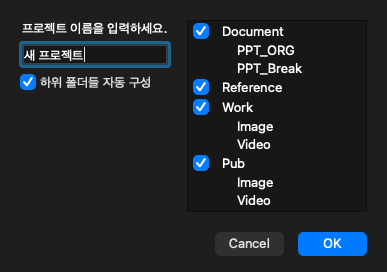

체크하는 것을 잊었어도 괜찮습니다. 프로젝트 맨 위에서 **이 위치에 하위 폴더 추가**를 누르면 빠진 폴더를 채워 줍니다. 폴더가 다 있으면 이 버튼은 눌리지 않습니다.

같은 이름의 프로젝트가 이미 있으면 알려 주고, 다른 이름을 적을 수 있게 다시 물어봅니다.

## PPT에서 사진 꺼내기

PPT 파일 안에 있는 사진을 한 번에 꺼내 줍니다.

1. 맨 위 칸에서 사진을 넣을 프로젝트를 고릅니다.
2. `.pptx` 파일을 프로그램 창으로 끌어다 놓습니다.
3. 프로젝트 이름이 맞는지 보고 **Yes**를 누릅니다.


그러면 파일이 이렇게 저장됩니다. 끌어다 놓은 원래 파일은 그대로 남습니다.

```text
프로젝트 이름
└── Document
    ├── PPT_ORG           PPT 원본
    └── PPT_Break
        └── media         PPT 안의 사진들
```

**이것만 기억하세요**

- `.ppt`로 끝나는 옛날 파일은 안 됩니다. PowerPoint에서 `.pptx`로 저장한 뒤 넣어 주세요.
- 한 프로젝트에서 사진을 꺼낼 수 있는 PPT는 하나입니다. `media` 폴더가 이미 있으면 원본만 저장되고, 사진은 꺼내지 않습니다.
- 다른 PPT의 사진을 꺼내려면 `media` 폴더를 다른 곳으로 옮기고, `PPT_ORG`에 있는 같은 이름의 파일도 옮긴 뒤 넣어 주세요.

## 사진 보기

**큰 아이콘, 작은 아이콘, 자세히** 버튼으로 보이는 모양을 바꿀 수 있습니다.

**작은 아이콘**: 한 화면에 많이 볼 수 있습니다.

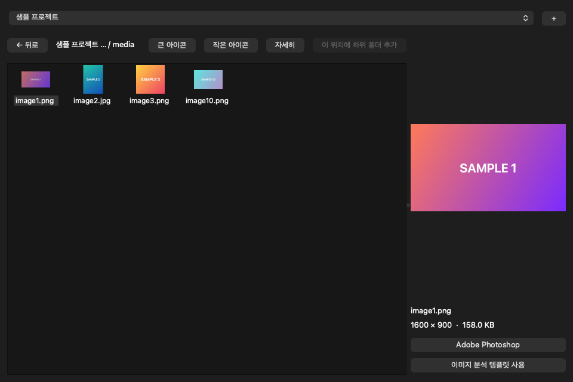

**자세히**: 파일 이름, 고친 날짜, 크기를 한눈에 볼 수 있습니다. 맨 위의 제목을 누르면 그 순서대로 정렬됩니다.

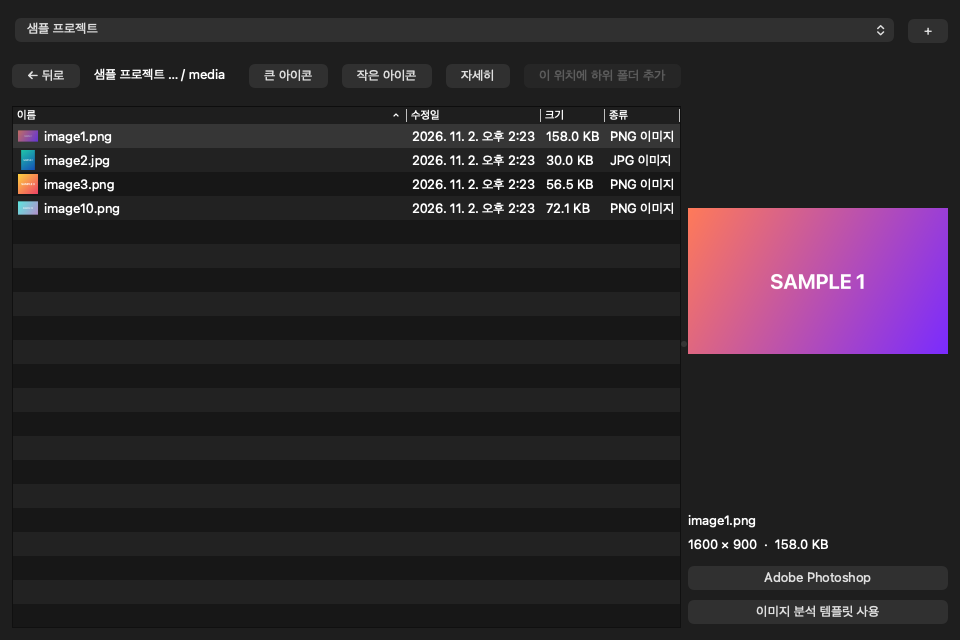

- 파일은 항상 이름순으로 먼저 나옵니다. `image2`가 `image10`보다 앞에 옵니다.
- Finder나 파일 탐색기에서 파일을 바꾸면 프로그램에도 저절로 반영됩니다.
- 동영상과 미리보기를 만들 수 없는 파일은 그림 대신 파일 모양 아이콘으로 나옵니다.

## 사진 고르기

| 하고 싶은 일 | 이렇게 합니다 |
|---|---|
| 한 장 고르기 | 사진을 한 번 클릭 |
| 이어진 여러 장 고르기 | 첫 사진을 클릭하고, `Shift`를 누른 채 마지막 사진을 클릭 |
| 원하는 것만 여러 장 고르기 | Mac은 `⌘`, Windows는 `Ctrl`을 누른 채 클릭 |
| 네모로 묶어서 고르기 | 사진이 없는 빈 곳에서 시작해 끌기 |

## 사진 사용하기

| 하고 싶은 일 | 이렇게 합니다 |
|---|---|
| 크게 보기 | 사진을 클릭하면 오른쪽에 크게 나옵니다 |
| 사진 프로그램으로 열기 | 사진을 더블클릭 |
| 포토샵으로 열기 | 사진 한 장을 고르고 **Adobe Photoshop** 클릭 |
| 분석 지시문 복사하기 | 사진을 고르고 **이미지 분석 템플릿 사용** 클릭 후, 원하는 곳에 붙여넣기 |
| 다른 곳으로 복사하기 | 사진을 잡아 Finder, 파일 탐색기, 바탕화면에 놓기 |
| 웹사이트에 올리기 | 사진을 잡아 웹페이지의 업로드 칸에 놓기 |

**이것만 기억하세요**

- 포토샵에서 저장하면 **원래 파일이 바뀝니다.**
- 웹사이트에 올리기는 끌어다 놓기가 되는 사이트에서만 됩니다.

## 컴퓨터에 있는 파일 넣기

Finder나 파일 탐색기에 있는 사진과 동영상을 **Work** 폴더 위에 끌어다 놓으면 복사됩니다.

1. 파일을 끌고 Work 폴더 위로 가져가면 폴더가 표시됩니다.

   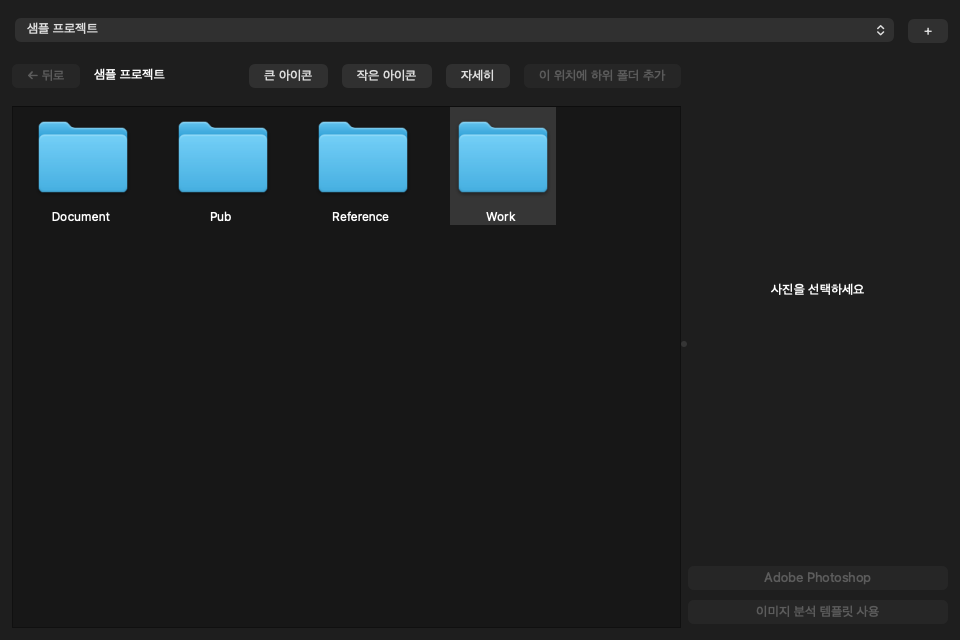

2. 손을 떼면 창이 뜹니다. **OK**를 누르면 복사되고, **Cancel**을 누르면 아무 일도 없습니다.

   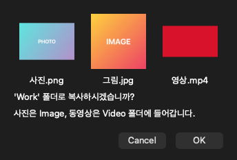

파일은 알아서 맞는 폴더로 들어갑니다.

| 파일 | 들어가는 곳 |
|---|---|
| 사진 | `Work/Image` |
| 동영상 | `Work/Video` |

**이것만 기억하세요**

- `Work` 폴더 안을 보고 있을 때는 빈 곳에 놓아도 됩니다.
- **Reference는 아직 준비 중입니다.** 창은 뜨지만 **OK**를 눌러도 복사되지 않습니다.
- 다른 폴더에 놓으면 아래처럼 알려 줍니다.

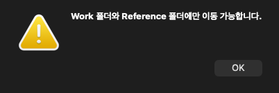

- 원래 파일은 그대로 남습니다. 같은 이름의 파일이 있으면 덮어쓰지 않습니다.
- 사진과 동영상이 아닌 파일은 건너뜁니다. PPTX는 [PPT에서 사진 꺼내기](#ppt에서-사진-꺼내기)로 처리됩니다.

## Work, Reference 안에서 정리하기

`Work`와 `Reference` 안에서는 사진뿐 아니라 **모든 파일**이 보입니다.

### 폴더 만들기

1. `Work`나 `Reference` 안에서 마우스 오른쪽 버튼을 누르고 **폴더 추가하기**를 고릅니다.
2. 폴더 이름을 적고 **+** 나 `Enter`를 누릅니다. 아래 목록에 쌓입니다.
3. 이름을 고치려면 목록에서 더블클릭합니다. 지우려면 고른 뒤 **선택 삭제**를 누릅니다.
4. **OK**를 누르면 폴더가 만들어집니다. **Cancel**을 누르면 아무것도 만들지 않습니다.

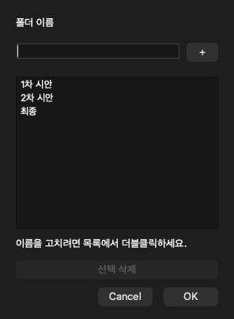

### 파일과 폴더 옮기기

| 하고 싶은 일 | 이렇게 합니다 |
|---|---|
| 폴더 안으로 옮기기 | 파일이나 폴더를 끌어 다른 폴더 위에 놓기 |
| 한 칸 위로 옮기기 | 파일이나 폴더를 끌어 **← 뒤로** 버튼 위에 놓기 |

**이것만 기억하세요**

- 복사가 아니라 **이동**입니다. 원래 있던 곳에서 사라집니다.
- 같은 이름이 있으면 덮어쓰지 않고 그대로 둡니다.
- `Work`와 `Reference` 사이나, 그 밖의 폴더로는 옮길 수 없습니다.

## Pub 폴더로 보내기

`Work`에 있는 파일이나 폴더를 `Pub`으로 보낼 수 있습니다.

1. 파일이나 폴더에 마우스 오른쪽 버튼을 누릅니다.

   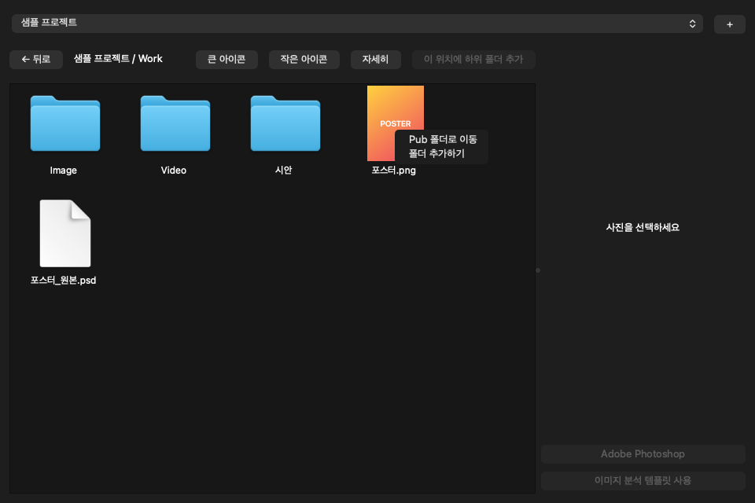

2. **Pub 폴더로 이동**을 고릅니다.
3. 창이 뜨면 **OK**를 누릅니다. **Cancel**을 누르면 아무 일도 없습니다.

   

폴더도 같은 방법으로 보낼 수 있습니다. 안에 있는 파일까지 모두 함께 갑니다.

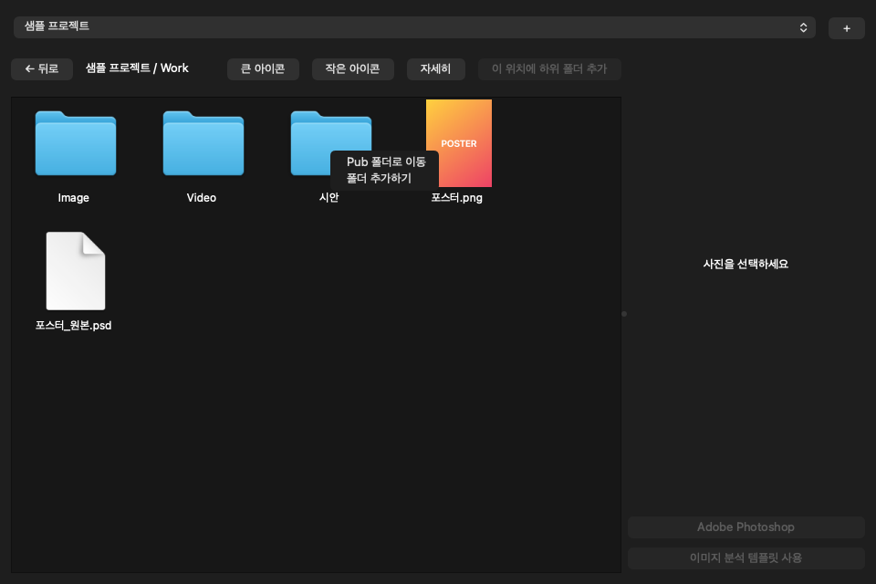

| Work에 있는 곳 | Pub에 들어가는 곳 |
|---|---|
| `Work/Image` | `Pub/Image` |
| `Work/Video` | `Pub/Video` |
| `Work/시안` | `Pub/시안` |

**이것만 기억하세요**

- 메뉴 이름은 "이동"이지만 실제로는 **복사**입니다. `Work`의 파일은 그대로 남습니다.
- 같은 이름의 파일이 있으면 덮어쓰지 않습니다.
- `Work` 안에서만 쓸 수 있습니다.

### Pub에서 지우기

`Pub` 안의 파일에 마우스 오른쪽 버튼을 누르고 **삭제(Pub 폴더에서만 삭제됩니다)** 를 고릅니다.

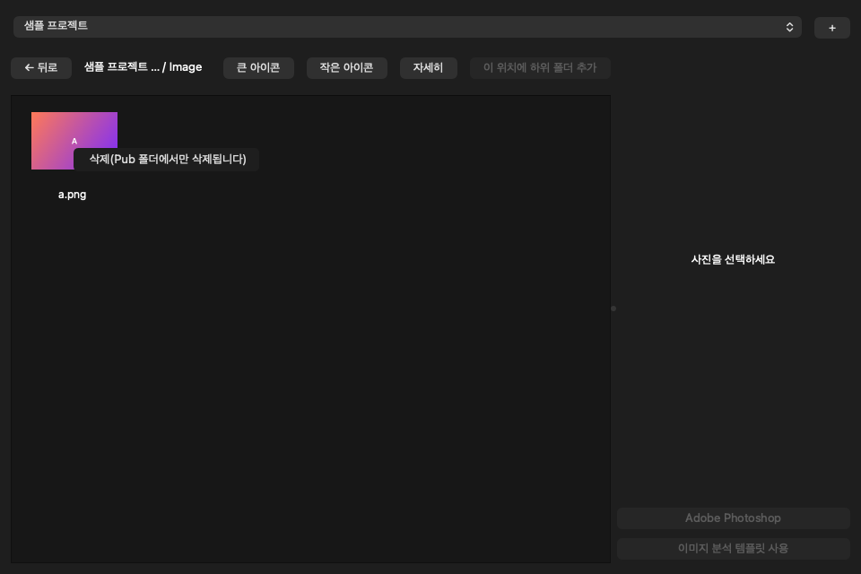

- 지운 파일은 휴지통으로 갑니다. 휴지통에서 되살릴 수 있습니다.
- `Work`에 있는 원래 파일은 지워지지 않습니다.
- 폴더는 이 메뉴로 지울 수 없습니다. Finder나 파일 탐색기에서 지워 주세요.

## 문제가 생겼을 때

### 설치할 때

| 화면에 나오는 말 | 이렇게 해 보세요 |
|---|---|
| `command not found: python3.12` (Mac) | 터미널을 완전히 닫고 다시 엽니다. 그래도 나오면 1단계를 다시 합니다. |
| `py`를 인식할 수 없다는 말 (Windows) | PowerShell을 닫고 다시 엽니다. 그래도 나오면 1단계를 다시 합니다. |
| `No such file or directory`, `경로를 찾을 수 없습니다` | `zipup_helper-main` 폴더가 **문서** 폴더 바로 안에 있는지 봅니다. |
| `ERROR`, `Could not` | 인터넷 연결을 확인하고 3단계의 세 번째 줄을 다시 합니다. |

### 쓰다가

| 이런 일이 생기면 | 이렇게 해 보세요 |
|---|---|
| "폴더 목록을 읽지 못했습니다" | `Project` 폴더를 만들고 프로그램을 다시 켭니다. |
| **Adobe Photoshop** 버튼이 안 눌립니다 | 파일을 한 개만 골랐는지 봅니다. |
| "Adobe Photoshop에서 열지 못했습니다" | 포토샵이 설치되어 있는지 봅니다. |
| **이미지 분석 템플릿 사용** 버튼이 안 눌립니다 | 사진을 골랐는지 봅니다. 동영상만 고르면 안 눌립니다. |
| **이 위치에 하위 폴더 추가**가 안 눌립니다 | 프로젝트 맨 위에서만 눌립니다. 폴더가 다 있어도 안 눌립니다. |
| PPT를 넣었는데 사진이 안 나옵니다 | 경고창 내용을 봅니다. `media` 폴더가 이미 있거나, 파일이 망가졌거나, 암호가 걸려 있을 수 있습니다. |

해결되지 않으면 화면을 캡처해서 관리자에게 보내 주세요.

## 아직 안 되는 것

- `Reference`에 끌어다 놓아도 아직 복사되지 않습니다.
- 프로젝트 폴더 위치를 프로그램에서 바꿀 수 없습니다. 내 홈 폴더의 `Project`만 씁니다.
- 옮기기를 되돌리는 버튼은 없습니다. 다시 끌어서 옮겨 주세요.
- 프로그램을 다시 켜면 보이는 모양은 **큰 아이콘**으로 돌아갑니다.
- 더블클릭으로 켜는 배포판은 아직 없습니다.
- Windows에서는 아직 시험 중입니다.

## 개발자용

Git으로 받기:

```bash
git clone git@github.com:Junsu1115/zipup_helper.git
```

테스트 실행:

```bash
# Windows는 .venv\Scripts\python
.venv/bin/python -m pytest --basetemp=.pytest_tmp
```

- `core/`: 폴더와 파일을 다루는 핵심 로직
- `ui/`: PySide6 화면 코드
- `tests/`: 테스트. 임시 폴더와 가짜 명령만 사용하며, 실제 프로젝트 폴더나 포토샵은 건드리지 않습니다.
- `docs/images/`: 이 설명서의 화면. 샘플 파일로 찍었습니다.
- `core/project_folders.py`의 `PROJECT_ROOT`: 프로젝트 폴더 위치
- `core/templates/image_analysis.txt`: 이미지 분석 지시문
- `.github/workflows/tests.yml`: 푸시할 때 macOS와 Windows에서 테스트를 자동 실행
- `CLAUDE.md`: 이 프로젝트의 개발 지침
